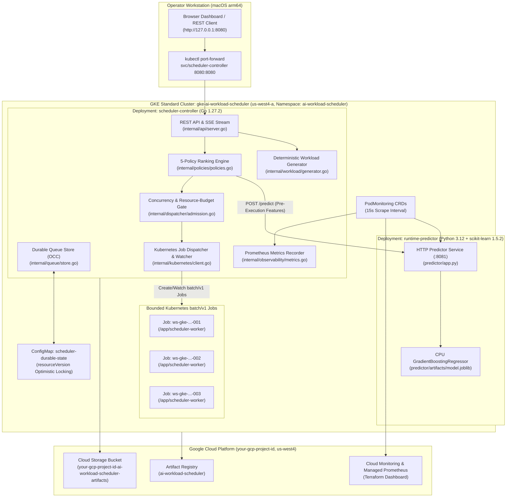
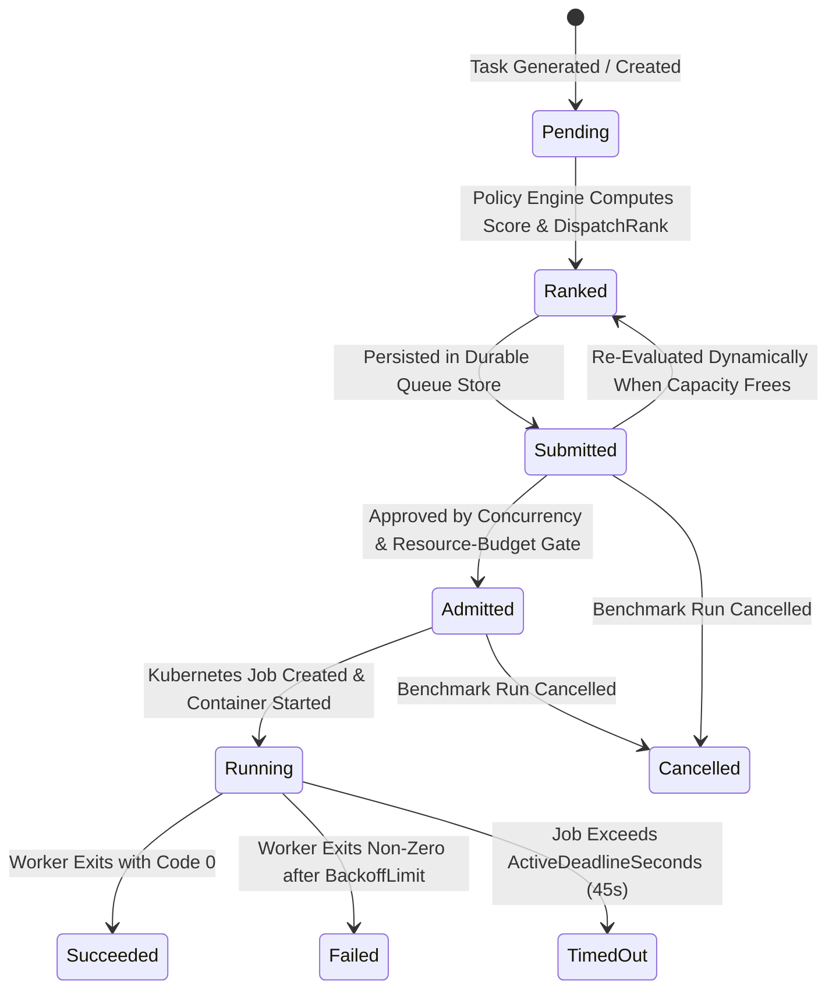

# Architecture Reference — `gke-ai-workload-scheduler`

## 1. System Architecture Overview

`gke-ai-workload-scheduler` is a CPU-only AI-assisted batch workload scheduling platform deployed on a dedicated zonal Google Kubernetes Engine (GKE) Standard cluster (`gke-ai-workload-scheduler` in `us-west4-a`) in project `your-gcp-project-id`.

---

## 2. Logical Component Responsibilities

| Component | Source Path | Responsibility |
|---|---|---|
| **Configuration & Guardrails** | [`internal/config/config.go`](internal/config/config.go) | Loads environment configuration, validates RFC 1123 DNS labels, and enforces safe concurrency (`[1, 16]`) and CPU/memory budget bounds. |
| **Workload Generator** | [`internal/workload/generator.go`](internal/workload/generator.go) | Generates deterministic, seeded task batches across 7 CPU workload classes (`short_cpu`, `long_cpu`, `variable_size`, `memory_sensitive`, `deadline_sensitive`, `mixed`, `priority`) with SHA-256 batch fingerprints. |
| **ML Runtime Predictor** | [`predictor/features.py`](predictor/features.py), [`predictor/train.py`](predictor/train.py), [`predictor/app.py`](predictor/app.py) | Validates pre-execution features, rejects leaked outcome fields (`actual_duration_sec`, `holdout_label`), trains a CPU `GradientBoostingRegressor`, evaluates holdout MAE/RMSE against global/class-median baselines, and serves `/predict`, `/metadata`, `/healthz`, and `/metrics`. |
| **Predictor Go Client & Fallback** | [`internal/predictor/client.go`](internal/predictor/client.go) | Invokes the Python predictor with bounded `2.5s` timeouts and falls back deterministically (`FallbackOne` / `FallbackBatch`) with explicit `fallback_used=true` telemetry if the service is unavailable. |
| **Scheduling Policy Engine** | [`internal/policies/policies.go`](internal/policies/policies.go) | Implements `fifo`, `sjf`, `edf`, `priority_aging`, and `ai_assisted`, producing a structured `ScoreBreakdown` and human-readable `DecisionReason` for every task. |
| **Durable Queue Store** | [`internal/queue/store.go`](internal/queue/store.go) | Manages task and benchmark run lifecycles with `IdempotencyKey` deduplication, `ResourceVersion` optimistic concurrency control (`ErrConflict`), atomic JSON persistence, and Kubernetes `ConfigMap` state mirroring (`scheduler-durable-state`). |
| **Admission Gate** | [`internal/dispatcher/admission.go`](internal/dispatcher/admission.go) | Enforces `MaxConcurrentJobs`, `MaxCPUBudgetMilli`, and `MaxMemoryBudgetMB`, tracking peak concurrency and resource requests. |
| **Kubernetes Dispatcher & Watcher** | [`internal/kubernetes/client.go`](internal/kubernetes/client.go) | Creates deterministic, hardened `batch/v1` Jobs, inspects Pod conditions (`PodScheduled`, `StartedAt`, `FinishedAt`), fetches container logs, and syncs durable state to Kubernetes ConfigMaps. |
| **Scheduler & Benchmark Engine** | [`internal/scheduler/engine.go`](internal/scheduler/engine.go) | Orchestrates discrete-event offline simulations (`RunSimulation`), 5-policy comparisons (`CompareAllPoliciesSimulation`), live GKE Job benchmarks (`RunLiveBenchmark`), and hypothesis evaluation (`EvaluateHypotheses`). |
| **REST API & Embedded Web UI** | [`internal/api/server.go`](internal/api/server.go), [`internal/api/ui/`](internal/api/ui/index.html) | Serves HTTP API endpoints, real-time SSE stream (`/api/v1/stream`), Prometheus `/metrics`, and the 6-tab browser UI. |
| **CPU Batch Worker Binary** | [`cmd/worker/main.go`](cmd/worker/main.go) | Executes calibrated CPU SHA-256 hashing and bounded memory working-set scans inside each Kubernetes `batch/v1` Job Pod. |

---

## 3. Logical Task Lifecycle State Machine

Every logical task transitions through well-defined states tracked in [`internal/workload/generator.go`](internal/workload/generator.go):

---

## 4. Scheduling Policy Interface & Mathematical Scoring

### 4.1 Policy Summary

1. **Policy A — `fifo` (First In, First Out)**:
   $$\text{rank\_key}(i) = (\text{ArrivalSequence}_i \uparrow, \text{TaskID}_i \uparrow)$$
2. **Policy B — `sjf` (Prediction-Based Shortest Job First)**:
   $$\text{rank\_key}(i) = (\hat{d}_i \uparrow, \text{ArrivalSequence}_i \uparrow, \text{TaskID}_i \uparrow)$$
   Uses strictly pre-execution predicted duration $\hat{d}_i$ (never future `ActualDurationSec`).
3. **Policy C — `edf` (Earliest Deadline First)**:
   Partitions tasks into three tiers at scheduling instant $t_{\text{now}}$:
   - **Tier 1 (Viable Deadlines, $\text{Deadline}_i \ge t_{\text{now}}$)**: Ordered by remaining time $\text{Deadline}_i - t_{\text{now}} \uparrow$.
   - **Tier 2 (Expired Deadlines, $\text{Deadline}_i < t_{\text{now}}$)**: Isolated after Tier 1 so already-expired tasks cannot cause cascading misses of viable deadlines; ordered by $\text{Priority}_i \downarrow$, then overdue time.
   - **Tier 3 (No Deadline)**: Ordered by $\text{Priority}_i \downarrow$, then $\text{ArrivalSequence}_i \uparrow$.
4. **Policy D — `priority_aging` (Priority with Anti-Starvation Aging)**:
   $$\text{EffectivePriority}(i, t_{\text{now}}) = \text{Priority}_i + 1.5 \cdot \frac{\max(0, t_{\text{now}} - t_{\text{submitted}, i})}{5.0\text{ s}}$$
   Ordered by $\text{EffectivePriority} \downarrow$, tie-broken by $\text{ArrivalSequence}_i \uparrow$.
5. **Policy E — `ai_assisted` (Multi-Objective AI-Assisted Scheduler)**:
   Ranks waiting tasks by ascending `schedule_score`:
   $$\text{schedule\_score}_i = \text{predicted\_runtime\_cost}_i + \text{deadline\_risk}_i + \text{resource\_pressure}_i - \text{priority\_benefit}_i - \text{aging\_benefit}_i$$
   where:
   - $\text{predicted\_runtime\_cost}_i = 3.5 \cdot \left(\frac{\hat{d}_i}{10.0}\right)$
   - $\text{deadline\_risk}_i = \begin{cases} 0 & \text{if no deadline} \\ -6.0 \cdot \frac{1}{1 + \max(0, s_i)/8.0} & \text{if predicted slack } s_i = (\text{Deadline}_i - t_{\text{now}}) - \hat{d}_i \ge -0.35\text{ s (viable)} \\ +1.5 & \text{if } s_i < -0.35\text{ s (predicted infeasible if started now)} \end{cases}$
   - $\text{resource\_pressure}_i = 1.0 \cdot \frac{1}{2}\left(\frac{\text{CPU}_i}{\text{CPU}_{\text{budget}}} + \frac{\text{Mem}_i}{\text{Mem}_{\text{budget}}}\right)$
   - $\text{priority\_benefit}_i = 2.5 \cdot \left(\frac{\text{Priority}_i}{10.0}\right)$
   - $\text{aging\_benefit}_i = 1.4 \cdot \min\left(2.5, \frac{w_i}{5.0\text{ s}}\right)$

---

## 5. Persistence, Idempotency, and Concurrency Safety

1. **Optimistic Concurrency Control (`ResourceVersion`)**:
   - Every `Task` and `BenchmarkRun` carries an integer `ResourceVersion` incremented on each mutation.
   - `Store.UpdateTaskConditional(taskID, expectedVersion, mutate)` rejects concurrent stale updates with `queue.ErrConflict`, while `UpdateTaskWithRetry` safely retries state transitions.
2. **Kubernetes-Native State Survival Across Pod Restarts**:
   - In cluster mode, `Store` mirrors its ledger into ConfigMap `scheduler-durable-state` in namespace `ai-workload-scheduler` using `client-go`'s `retry.RetryOnConflict` (which enforces Kubernetes `metadata.resourceVersion` conditional updates) and writes per-run summary ConfigMaps (`run-<run_id>`).
   - If the `scheduler-controller` Pod restarts, `NewStore` automatically restores all historical runs and task states from `scheduler-durable-state`.
3. **End-to-End Idempotency**:
   - Every task and benchmark run has a deterministic `IdempotencyKey` (`idem-<run_id>-<seq>`) and deterministic Kubernetes Job name (`ws-<run_id>-<seq>`).
   - Duplicate API calls or network retries return the existing task/Job without launching duplicate Pods.

---

## 6. Security, Workload Identity, and Network Boundaries

- **Zero Service-Account Keys**:
  - `scheduler-controller-sa` binds to `ai-ws-controller-sa@your-gcp-project-id.iam.gserviceaccount.com` via GKE Workload Identity (`roles/iam.workloadIdentityUser`).
  - Worker Pods (`scheduler-worker-sa`) and predictor Pods (`runtime-predictor-sa`) set `automountServiceAccountToken: false` so batch workloads cannot access the Kubernetes API server.
- **Container Hardening**:
  - All containers run as non-root UID/GID `65532:65532` with `readOnlyRootFilesystem: true`, `allowPrivilegeEscalation: false`, `capabilities.drop: ["ALL"]`, and `seccompProfile: RuntimeDefault`.
- **Internal-Only Network Exposure**:
  - Nodes run with private IPs (`enable_private_nodes = true`) and reach Artifact Registry / Cloud Monitoring via Private Google Access (`private_ip_google_access = true`).
  - All Kubernetes Services (`scheduler-controller`, `runtime-predictor`) are `ClusterIP`. Administrative and UI access uses authenticated local `kubectl port-forward`.
