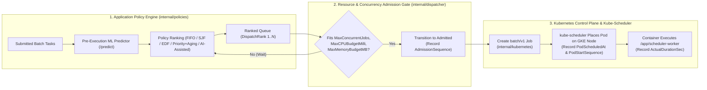

# Feasibility and Architectural Trade-Offs — `gke-ai-workload-scheduler`

## 1. Phase 1 Preflight Findings Summary

| Check Category | Observed State (`2026-10-24`) | Assessment |
|---|---|---|
| **GCP Identity & Project** | `user@example.com` on project `your-gcp-project-id` (`123456789012`), `lifecycleState: ACTIVE` | Verified |
| **Target Region / Zone** | `us-west4` / `us-west4-a` | Verified |
| **Existing Project Resources** | `0` GKE clusters, `0` GCE instances, `0` persistent disks, `0` GCS buckets, `0` Artifact Registry repos, `1` `default` VPC | Zero resource conflicts |
| **Quotas (`us-west4`)** | `CPUS`: `0/200`, `E2_CPUS`: `0/24`, `DISKS_TOTAL_GB`: `0/4096`, `SSD_TOTAL_GB`: `0/500`, `INSTANCES`: `0/24` | Ample quota headroom |
| **Local Host & Toolchain** | macOS `arm64`, Go `1.27.2`, Python `3.13.16` + `uv`, Terraform `v1.16.5`, `gcloud` `590.0.0`, `kubectl` `v1.37.1` (`kustomize v5.8.1`), Docker `29.9.0` | Verified |
| **Go/No-Go Recommendation** | **GO** — All cloud quotas, permissions, APIs, and local build toolchains are verified. | Proceed |

---

## 2. CPU-Only Feasibility for AI-Assisted Workload Scheduling

A core question of this project is whether a **CPU-only** machine learning model can provide accurate, low-latency runtime predictions that meaningfully improve batch scheduling decisions on GKE without requiring GPUs, TPUs, or external LLM APIs.

### Why CPU-Only `scikit-learn` (`GradientBoostingRegressor`) Fits Batch Scheduling

1. **Tabular Pre-Execution Feature Space**:
   - Batch job scheduling metadata (`workload_class`, `input_size`, `cpu_request_milli`, `memory_request_mb`, `compute_intensity`, `memory_working_set_mb`, `historical_class_mean_sec`, and nonlinear interaction terms like `work_per_cpu_unit`) is low-dimensional tabular data (`17` features after one-hot encoding and derived ratios).
   - On tabular regression tasks with $10^3$–$10^4$ samples, tree ensembles (`GradientBoostingRegressor`) achieve sub-millisecond inference latency (`~0.3–1.2 ms` per batch on CPU) and train in `< 1.5 seconds` on a single CPU core.
2. **Zero Accelerator Dependency**:
   - By running `runtime-predictor` on CPU (`100m` request / `500m` limit, `256Mi` memory request), the predictor adds negligible overhead to the GKE cluster while achieving **`0.2443s` Holdout MAE** (an **`89.3%` reduction in MAE** over the per-class median baseline of `2.2836s`).

---

## 3. Separating Policy Ranking, Resource Admission, and Kubernetes Pod Placement

A common flaw in custom Kubernetes batch schedulers is conflating **logical queue ranking** with **cluster capacity admission** and **node-level Pod placement**. In `gke-ai-workload-scheduler`, these three responsibilities are strictly separated and instrumented:

1. **Stage 1 — Application Policy Ranking ([`internal/policies/policies.go`](internal/policies/policies.go))**:
   - Computes `DispatchRank` and `ScoreBreakdown` across waiting tasks.
   - Dynamic policies (`priority_aging`, `edf`, `ai_assisted`) re-evaluate waiting tasks whenever an execution slot frees up so elapsed waiting time (`aging_benefit`) and remaining deadline slack (`deadline_risk`) are always current.
2. **Stage 2 — Concurrency & Resource-Budget Admission Gate ([`internal/dispatcher/admission.go`](internal/dispatcher/admission.go))**:
   - Enforces `MaxConcurrentJobs` (default `4`), `MaxCPUBudgetMilli` (`2000m`), and `MaxMemoryBudgetMB` (`4096Mi`).
   - Prevents head-of-line resource over-admission and records `AdmissionSequence` and `AdmittedAt`.
3. **Stage 3 — Kubernetes Job Controller & `kube-scheduler` ([`internal/kubernetes/client.go`](internal/kubernetes/client.go))**:
   - The application does **not** bypass `kube-scheduler` or bind Pods directly to nodes.
   - Instead, once a task passes the admission gate, the dispatcher creates a standard `batch/v1` `Job`. Kubernetes `job-controller` creates the Pod, and `kube-scheduler` places the Pod onto `cpu-worker-pool` based on real node allocatable resources.
   - The controller observes and records `JobCreatedAt`, `PodScheduledAt`, `StartedAt`, `FinishedAt`, and `PodStartSequence`, explicitly reporting whether `DispatchRank == AdmissionSequence` and `AdmissionSequence == PodStartSequence`.

---

## 4. Evaluation of Optional Kueue Integration

We evaluated integrating **Kueue** (`kueue.x-k8s.io/v1beta1`) against our custom dispatcher (`internal/dispatcher/admission.go`) per Section 9:

| Criterion | Kueue (`ClusterQueue` / `LocalQueue`) | Custom Concurrency & Budget Dispatcher (`internal/dispatcher`) |
|---|---|---|
| **Static Quota & Multi-Tenant Borrowing** | Excellent for static `WorkloadPriorityClass` and multi-team cohort borrowing | Enforces configurable single-namespace `MaxConcurrentJobs`, `MaxCPUBudgetMilli`, and `MaxMemoryBudgetMB` |
| **Dynamic Continuous AI Scoring & Aging** | Kueue orders waiting `Workload` CRs by static integer `WorkloadPriorityClass` or `StrictFIFO`. Dynamic time-varying scores (`aging_benefit`, continuous `deadline_risk`) would require continuous mutation of `Workload` priority labels, creating race conditions between two competing queue authorities. | Re-ranks waiting tasks in memory/store at the exact millisecond a slot opens, guaranteeing that the AI policy's dynamic score directly governs admission order without a competing queue controller. |
| **Control-Plane Footprint on Single Node** | Adds `kueue-controller-manager` webhook + cert-manager/internal certs (`~150m–250m` CPU, `~256Mi` RAM) | Zero additional webhook pods; built into `scheduler-controller` (`100m` CPU, `128Mi` RAM) |

**Decision**:
To avoid creating two competing scheduling authorities where Kueue's static queue ordering could override the AI policy's continuous dynamic ranking (`schedule_score`), we use the explicit in-controller **Concurrency & Resource-Budget Admission Gate (`internal/dispatcher/admission.go`)** for the primary implementation and document how Kueue `ClusterQueue` / `ProvisioningRequest` can wrap multi-tenant deployments in [`docs/learning/07-queue-and-admission-management.md`](./docs/learning/07-queue-and-admission-management.md).
